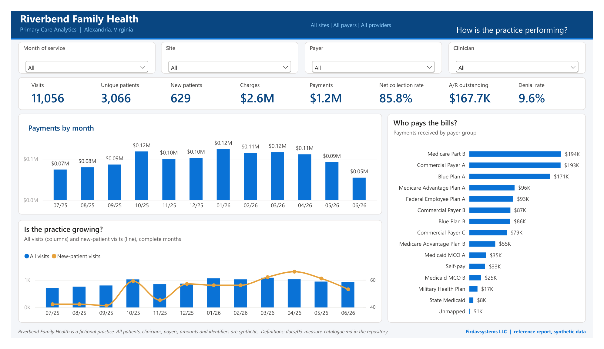

# Practice Data Platform Standard (Open Edition)

[](https://doi.org/10.5281/zenodo.23458671)

A written standard, with a working reference kit, for building a data
platform for a small independent medical practice: what the data means,
how each measure is calculated, which tests the data has to pass, and how
the result is assessed. It is meant to be delivered by someone other than
its author.

This is the open edition of the Firdavsystems LLC *Practice Data Platform
Reference Architecture and Implementation Package*, version 1.1.

**This repository contains no real patient data.** Everything under
`synthetic-data/` is generated for an invented practice.

## Who it's for

Practices with fewer than 20 clinicians, and whoever builds their data
platform:

- the practice's own IT contractor
- a regional extension center or practice support organization
- a management services organization working with several practices
- any data engineer who knows Microsoft Fabric and Power BI

None of them need us to use it. Two deployments that follow it measure the
same things the same way, so their baselines can be compared.

## What's here

| | |
|---|---|
| `docs/01-scope-and-principles.md` | scope, principles, target environment |
| `docs/02-data-definitions.md` | conformed entities, fields, keys, code sets |
| `docs/03-measure-catalogue.md` | every standard measure: definition, grain, source fields |
| `docs/04-data-quality-tests.md` | tests D1-D19, thresholds, stop / warn |
| `docs/05-dataops-and-delivery.md` | delivery phases, environments, versioning, refresh, handover |
| `docs/06-security-and-tenancy.md` | practice-owned tenant, controls |
| `docs/07-assessment-baselines.md` | baselines B1-B4 and how each is measured |
| `docs/08-implementer-guide.md` | step by step, plus known gaps |
| `synthetic-data/` | seeded generator and a 12-month sample (PM export, accounting, flattened 837P/835) |
| `fabric/` | three notebooks, three lakehouses, a Direct Lake semantic model (TMDL) and a reference report (PBIR) |
| `tools/run_local.py` | runs the notebooks on your machine against the sample |

## Try it

```
pip install -r tools/requirements.txt
python tools/run_local.py
```

About ten seconds. It loads the sample into a local Bronze / Silver / Gold
(Delta tables under `_local/`), runs the nineteen tests and builds the
star schema the model reads. To deploy in a real tenant, follow
`docs/08-implementer-guide.md`.

## How it fits together

```
PM/EHR export ─┐
accounting ────┼─> lh_bronze ──nb_01──> lh_silver ──nb_02──> (tests pass?) ──nb_03──> lh_gold ──> semantic model ──> app
X12 835/837 ───┘   files as received    conformed entities    D1..D19              star schema    Direct Lake        audiences
```

Everything runs inside the practice's own Microsoft tenant.

## What the report looks like

The reference report on the synthetic sample, rendered in Power BI Desktop
from the Gold tables that `tools/run_local.py` builds. All names and
numbers are invented.



Other pages: [volume and access](docs/img/report-02-volume-and-access.png) ·
[scheduling](docs/img/report-03-scheduling.png) ·
[revenue](docs/img/report-04-revenue.png) ·
[payers](docs/img/report-05-payers.png) ·
[collections and A/R](docs/img/report-06-collections-and-ar.png) ·
[denials](docs/img/report-07-denials.png)

## What it is not

- Not an EHR, and not a replacement for any part of one.
- Not a hosted service. Nothing here runs anywhere except in the practice's
  tenant (or on your laptop, with synthetic data).
- Not a certified product, and not a compliance determination. See `docs/06`.
- Not vendor-specific. Inputs follow public formats (X12, CMS code sets);
  a vendor's export is mapped onto them.

## Status

Version 1.0. The documents are complete; the reference kit has gaps that
are listed at the end of `docs/08` (no pipeline definition, no RLS roles
yet, full reload rather than incremental). The report is for reference.

## Citing

See `CITATION.cff`, or cite the archived release: Erkinov, F. (2026). *Practice Data Platform Standard, Open Edition* (v1.0.0). Firdavsystems LLC. https://doi.org/10.5281/zenodo.23458671

## License

Documents (`docs/`, this README): CC BY 4.0, see `LICENSE-docs`.
Code, notebooks, model and report definitions, generator: Apache-2.0, see `LICENSE`.
